

<a href="https://jhez-cafe.vercel.app">
  
</a>

 

 

<a href="#about"><kbd>&nbsp;Barista&nbsp;</kbd></a>&nbsp;
<a href="#ingredients"><kbd>&nbsp;Ingredients&nbsp;</kbd></a>&nbsp;
<a href="#menu"><kbd>&nbsp;Signature Drinks&nbsp;</kbd></a>&nbsp;
<a href="#shelf"><kbd>&nbsp;The Shelf&nbsp;</kbd></a>&nbsp;
<a href="#roast"><kbd>&nbsp;Roast Log&nbsp;</kbd></a>&nbsp;
<a href="#wall"><kbd>&nbsp;Wall&nbsp;</kbd></a>&nbsp;
<a href="#grind"><kbd>&nbsp;Daily Grind&nbsp;</kbd></a>

 


Hi, I'm **Jhezra**, a Computer Science student at **FEU Institute of Technology** (Software Engineering, class of 2027), a **DOST-SEI** and **University Elite Scholar**, and a Software Engineering Intern at **Ed3N Ventures**.

At Ed3N I work **AI-first**: I direct coding agents instead of hand-writing every line, and I put my effort into the harnesses, guardrails and code review that keep their output accountable. Before that I led the web development team, and earlier the academics committee, of the **FEU Tech ACM Student Chapter**. My thesis, **KitaKo**, puts Taglish-aware image search directly on your phone.

 

  

 

  
    
  

 


  <a href="https://github.com/TadeyRuk/Homestead"></a>
  <a href="https://fit-cs-expo.vercel.app"></a>

  <a href="https://kitako-eight.vercel.app"></a>
  <a href="https://romeo-04.github.io/kislap/"></a>

  
    <b>Homestead</b> <a href="https://github.com/TadeyRuk/Homestead">code</a> &nbsp;·&nbsp;
    <b>CS Expo</b> <a href="https://fit-cs-expo.vercel.app">live</a> &nbsp;·&nbsp;
    <b>KitaKo</b> <a href="https://kitako-eight.vercel.app">live</a> / <a href="https://github.com/Emyol/Stochastic4-Website">code</a> &nbsp;·&nbsp;
    <b>Kislap</b> <a href="https://romeo-04.github.io/kislap/">play</a> / <a href="https://github.com/Romeo-04/kislap">code</a>
  

 

| No. | Item | Tasting notes | Brewed with | Order |
|:-:|:--|:--|:--|:-:|
| `No.05` | **CitySense Live Geo** | Geospatial cockpit for urban planning, on live WMTS/WMS layers | TypeScript · Leaflet · Vite · Node.js | [code](https://github.com/Romeo-04/citysense-live-geo) |
| `No.06` | **TrackHab** | Habit tracker with contribution-style heatmaps | Next.js · Prisma · PostgreSQL · NextAuth | [live](https://smart-habit-tracker-fawn.vercel.app) · [code](https://github.com/Romeo-04/smart-habit-tracker) |
| `No.07` | **Archeon** | AI architectural-memory tool built at the Cognee hackathon | Python · Cognee · Knowledge Graphs · LLMs | [live](https://kishiagaytano.github.io/archeon/) · [code](https://github.com/kishiagaytano/archeon) |
| `No.08` | **FinHealth Platform** | Recommendation engine for Philippine rural banks | FastAPI · React · scikit-learn · Pydantic | [code](https://github.com/Romeo-04/finhealth-saas) |
| `No.09` | **Cha-Tsing** | Offline-first personal-finance PWA with a monkey mascot | React · Vite · PWA | [live](https://romeo-04.github.io/Cha-Tsing/) · [code](https://github.com/Romeo-04/Cha-Tsing) |
| `No.10` | **STARSight** | Civic-tech dashboard for DOST-SEI's STAR program | FastAPI · pandas · Nuxt 3 · Leaflet · Chart.js | [code](https://github.com/Romeo-04/datara) |
| `No.11` | **Codex Fuel** | VS Code sidebar that tracks your Codex CLI usage | TypeScript · VS Code Extension API | [code](https://github.com/Romeo-04/codex-fuel) |
| `No.12` | **ArkiRev** | Floor-plan diff tool for construction reviews | Python · Streamlit | [code](https://github.com/Romeo-04/arki-rev) |
| `No.13` | **ACMX Merch Shop** | E-commerce for a 400+ member student org | Next.js 14 · Prisma · Supabase · Zustand · GSAP | *in-house* |

 

  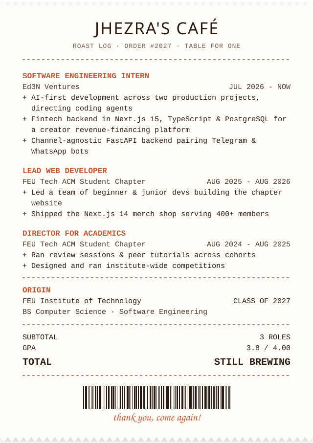

 


  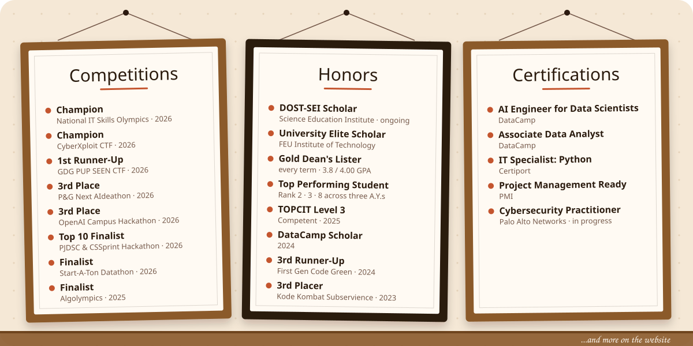

 

  
  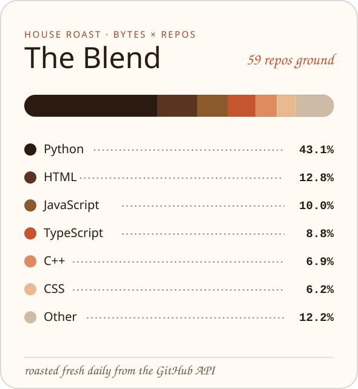

  

  

  <picture>
    <source media="(prefers-color-scheme: dark)" srcset="https://raw.githubusercontent.com/Romeo-04/Romeo-04/brew-output/coffee-snake-dark.svg" />
    
  </picture>

 

  <a href="https://jhez-cafe.vercel.app"></a>
    
  
   
  <a href="#top">back to the counter ↑</a> · stats re-brewed daily by GitHub Actions

